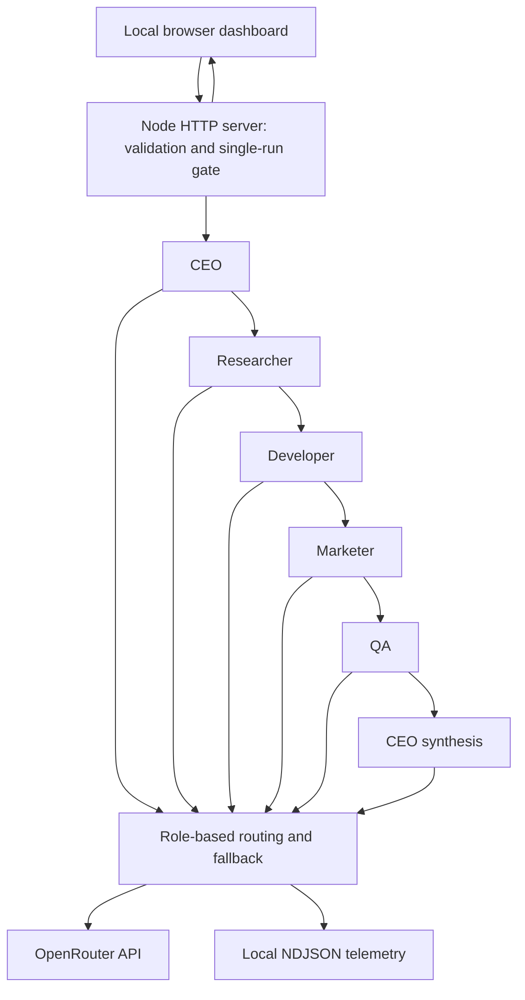
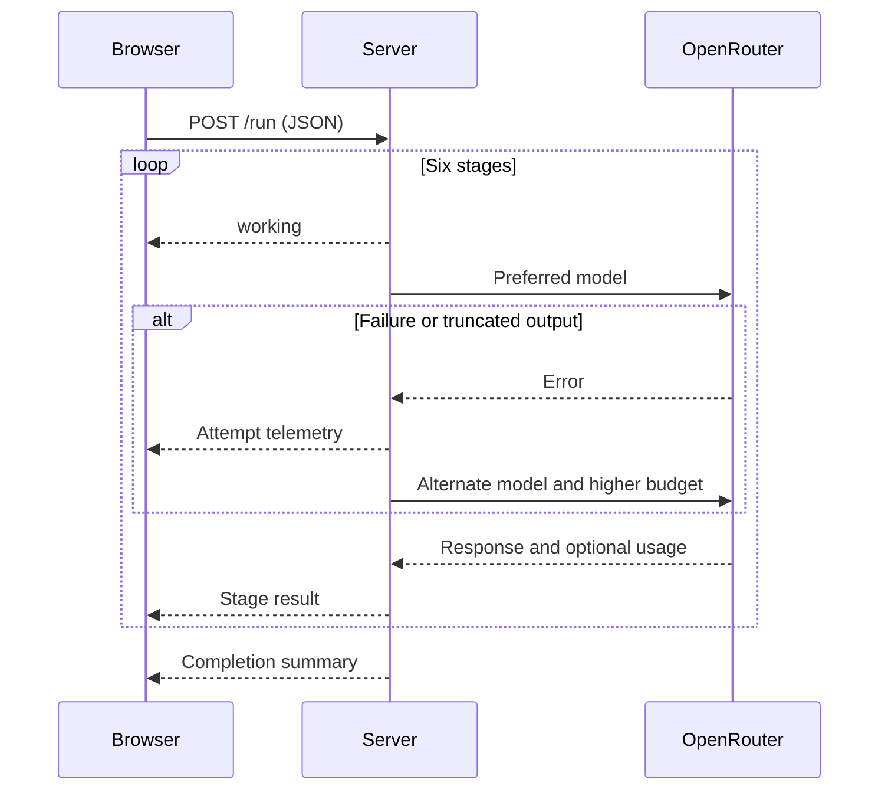

# Architecture

Each stage receives previous reports as untrusted data. Models are sequential, not autonomous tool users. The router selects distinct free candidates and escalates budgets (1600, 3000, 4500, 6000). Failed stages are represented in subsequent context. Responses stream as NDJSON events; browser renders text rather than HTML. API key stays server-side. No independent web research or code execution.

